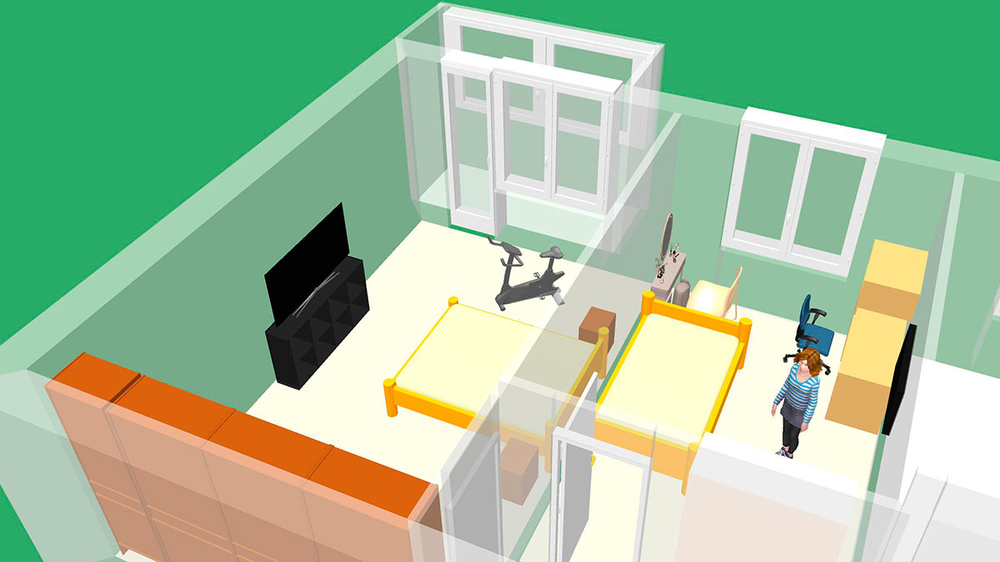
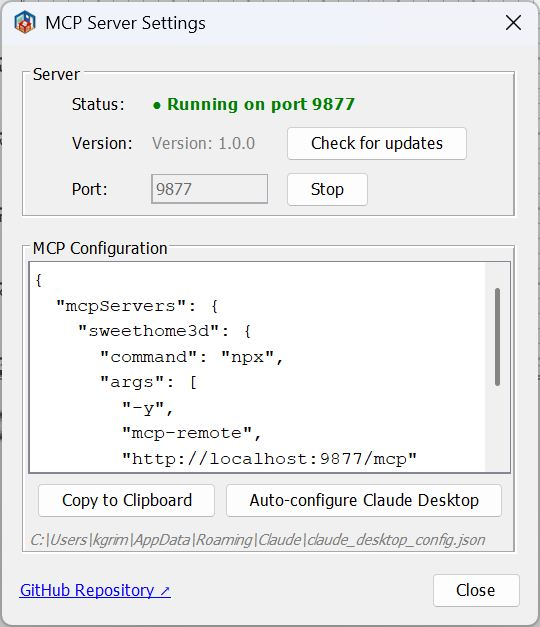

# Sweet Home 3D MCP Plugin

[](LICENSE)
[](https://adoptium.net/)
[](https://www.sweethome3d.com/)

A plugin for [Sweet Home 3D](https://www.sweethome3d.com/) that embeds an MCP (Model Context Protocol) server directly inside the application. Lets Claude and other AI assistants control Sweet Home 3D over HTTP — create walls, place furniture, render photos, and more — without any external proxy or separate server process.

```
Claude Desktop / Claude Code
         │  HTTP (JSON-RPC 2.0)
         ▼
┌─────────────────────────────────────┐
│  Sweet Home 3D  +  MCP Plugin       │
│  Built-in HTTP server on port 9877  │
│  http://127.0.0.1:9877/mcp         │
└─────────────────────────────────────┘
```

Claude Code connects to this endpoint directly. Claude Desktop needs a small local bridge (`mcp-remote`) in
between — see [Claude Configuration](#claude-configuration).

## Screenshots





## Requirements

| Requirement | Version |
|-------------|---------|
| [Sweet Home 3D](https://www.sweethome3d.com/download.jsp) | 7.x (tested with 7.5) |
| Java (bundled with SH3D or system) | 8 or newer |
| [Node.js](https://nodejs.org/) | current LTS — only for Claude Desktop (runs the `mcp-remote` bridge) |

The plugin works with Sweet Home 3D's bundled Java 8 runtime. Building the plugin requires JDK 11+; running it does not.

## Installation

**Step 1.** Download `sh3d-mcp-plugin-1.2.0.sh3p` from [Releases](../../releases).

**Step 2.** Install it.

*macOS (easiest): double-click the `.sh3p` file.* Sweet Home 3D opens, installs the
plugin itself and confirms with a dialog. Nothing to copy by hand. If Finder does not
open the file with Sweet Home 3D, right-click it and choose **Open With → Sweet Home 3D**.
Double-clicking works the same way on Windows and Linux wherever the `.sh3p` extension
is associated with Sweet Home 3D.

*Any platform (manual): copy the file into the plugins folder*, creating the folder if
it does not exist:

| OS | Plugins folder |
|----|----------------|
| Windows | `%APPDATA%\eTeks\Sweet Home 3D\plugins\` |
| macOS | `~/Library/Application Support/eTeks/Sweet Home 3D/plugins/` |
| Linux | `~/.eteks/sweethome3d/plugins/` |

**Step 3.** (Re)start Sweet Home 3D. The MCP server starts automatically on port `9877`.

> You can verify it is running: **Tools → MCP Server...** shows the server status.

## Troubleshooting

### macOS: the MCP server won't start (cannot open port)

The **Mac App Store** build of Sweet Home 3D is sandboxed and ships without the
`com.apple.security.network.server` entitlement, so it is not allowed to open a
listening socket. Because the plugin listens on port `9877`, the MCP server
cannot start under that build.

**Fix:** use a non-sandboxed build of Sweet Home 3D — the standalone "Java
version" / installer from [sweethome3d.com](https://www.sweethome3d.com/)
instead of the Mac App Store version.

## Authentication

Token authentication is **off by default**. In this mode clients connect without an
`Authorization` header, and the plugin creates no token files or changes to existing token files.
**Any program running on this machine can control Sweet Home 3D through the MCP endpoint, including writing files with the permissions of Sweet Home 3D.**
Enable token authentication if untrusted programs or other users share the machine.

To require authentication, select **Require a token** in **Tools → MCP Server...**. The change takes
effect on the next request, including requests in existing sessions, without restarting the server.
The setting is saved as `sh3d.mcp.requireToken=true` in `sh3d-mcp.properties` in the plugins folder.
The JVM property `-Dsh3d.mcp.requireToken=true|false` overrides that file and locks the checkbox.
Clear the checkbox to allow connections without a token again; existing token files are left in place.

When authentication is enabled, every request to `/mcp` must carry `Authorization: Bearer <token>`;
a missing or incorrect token returns `401`. `/health` does not require a token.
The plugin generates a random token (32 bytes, base64url) when needed and stores it next to the
plugin, readable only by you (`0600` on POSIX, an explicit owner-only ACL on Windows):

| File | Contents |
|------|----------|
| `sh3d-mcp.token` | the raw token |
| `sh3d-mcp.token.headers` | `Authorization: Bearer <token>` (for `mcp-remote --header-file`) |

Both live in the plugins folder listed above. **Tools → MCP Server...** shows the token (masked),
lets you copy it, and lets you **rotate** it when authentication is enabled; clients using the
old token then get `401`. If token storage is unavailable, enabling authentication fails, and a
server configured to require a token refuses to start. Token values are never written to logs or
client configuration files.

With authentication enabled, configure Claude Code using `headersHelper` or `--header`, and
Claude Desktop using `mcp-remote --header-file`, as shown below.

**Host/Origin checks apply in both modes**, to `/mcp` and `/health`. The server listens only on
`127.0.0.1` and rejects (`403`) any request whose `Host` is not `127.0.0.1:<port>` or
`localhost:<port>`, or that carries an `Origin` other than `http://127.0.0.1:<port>` /
`http://localhost:<port>` (DNS-rebinding and cross-site protection). No CORS headers are sent.
Host and Origin comparisons ignore case; repeated or comma-separated values are rejected.
On port 80, the same addresses without `:80` are also accepted.
Request bodies are limited to 5 MB (`413`).

## Claude Configuration

Start Sweet Home 3D first: the MCP server exists only while the application is running.

### Claude Code (recommended)

With the default token-free mode, copy `.mcp.json.example` to `.mcp.json` in your project directory,
or register the endpoint with:

```bash
claude mcp add --transport http sweethome3d http://127.0.0.1:9877/mcp
```

**When token authentication is enabled**, use the following `.mcp.json`. `headersHelper` reads the
token file on every connect, so the token is never copied into the config and a rotation is picked
up automatically (macOS path shown; adjust for your OS):

```json
{
  "mcpServers": {
    "sweethome3d": {
      "type": "http",
      "url": "http://127.0.0.1:9877/mcp",
      "headersHelper": "printf '{\"Authorization\":\"Bearer %s\"}' \"$(cat \"$HOME/Library/Application Support/eTeks/Sweet Home 3D/plugins/sh3d-mcp.token\")\""
    }
  }
}
```

Alternatively, with a static header (you must update it after a rotation):

```bash
claude mcp add --transport http sweethome3d http://127.0.0.1:9877/mcp \
  --header "Authorization: Bearer <token>"
```

### Claude Desktop

Claude Desktop does not load `"type": "http"` entries from `claude_desktop_config.json` — such an entry is ignored.
It starts MCP servers as local commands, so the plugin is reached through a pinned
[`mcp-remote`](https://www.npmjs.com/package/mcp-remote) bridge (requires [Node.js](https://nodejs.org/)).
In the default token-free mode, add this to `claude_desktop_config.json`:

```json
{
  "mcpServers": {
    "sweethome3d": {
      "command": "npx",
      "args": ["-y", "mcp-remote@0.14.3", "http://127.0.0.1:9877/mcp"]
    }
  }
}
```

**When token authentication is enabled**, add `--header-file` and the absolute path to the headers
file as below (macOS path shown). The token is read from that file and never appears in the config
or on the process command line:

```json
{
  "mcpServers": {
    "sweethome3d": {
      "command": "npx",
      "args": [
        "-y", "mcp-remote@0.14.3", "http://127.0.0.1:9877/mcp",
        "--header-file", "/Users/<you>/Library/Application Support/eTeks/Sweet Home 3D/plugins/sh3d-mcp.token.headers"
      ]
    }
  }
}
```

Then quit Claude Desktop completely and start it again.

> The built-in **"Auto-configure Claude Desktop"** button in **Tools → MCP Server...** writes this
> entry for the current token mode, including the headers path only when authentication is enabled
> (and keeps a `.bak` copy of the previous config). The **Copy to Clipboard** button uses the same mode.
> Configure the client again after changing token mode, and restart Claude Desktop after rotating the token.

## Available Commands

46 commands across 14 categories.

### Scene

| Command | Description |
|---------|-------------|
| `get_state` | Full scene state: walls, furniture, rooms, camera, labels, levels |
| `clear_scene` | Remove all objects from the scene |

### Walls

| Command | Description |
|---------|-------------|
| `create_wall` | Single wall between two points |
| `create_walls` | Rectangular room (4 connected walls) |
| `modify_wall` | Change height, thickness, color, arc, coordinates |
| `delete_wall` | Delete wall by ID |
| `connect_walls` | Connect two walls for correct corner rendering |

### Rooms

| Command | Description |
|---------|-------------|
| `create_room_polygon` | Room from an array of polygon points |
| `modify_room` | Change name, floor/ceiling color, visibility |
| `delete_room` | Delete room by ID |

### Furniture

| Command | Description |
|---------|-------------|
| `list_categories` | All furniture catalog categories with item counts |
| `list_furniture_catalog` | Browse catalog; filter by name, category, or type |
| `place_furniture` | Place a catalog item in the scene |
| `modify_furniture` | Move, rotate, resize, recolor furniture by ID; set door/window swing arcs (`sashPreset` / `sashes`) |
| `delete_furniture` | Delete furniture by ID |
| `duplicate_objects` | Duplicate one or more objects by ID |
| `group_furniture` | Group multiple pieces into one object |
| `ungroup_furniture` | Split a group back into individual pieces |

### Doors & Windows

| Command | Description |
|---------|-------------|
| `place_door_or_window` | Place from catalog into a wall (auto-computes position and angle); optional `sashPreset` / `sashes` for the plan's swing arc |

### Textures & Appearance

| Command | Description |
|---------|-------------|
| `list_textures_catalog` | Browse texture catalog; filter by name or category |
| `apply_texture` | Apply catalog texture to wall side or room surface |
| `set_environment` | Ground/sky colors, lighting, wall transparency, drawing mode |

### 3D Shapes

| Command | Description |
|---------|-------------|
| `generate_shape` | Create custom 3D geometry: primitives (box, sphere, cylinder, cone, wedge, arch, stairs, torus, hemisphere, pipe), extrude, mesh, and CSG boolean operations (union, subtract, intersect) |

### Annotations

| Command | Description |
|---------|-------------|
| `add_label` | Text annotation on the 2D floor plan |
| `modify_label` | Change a label's text, position, angle, colors, font style or 3D placement by ID |
| `delete_label` | Delete label by ID |
| `add_dimension_line` | Measurement line with auto-offset |
| `modify_dimension_line` | Move a dimension line's endpoints or offset by ID |
| `delete_dimension_line` | Delete dimension line by ID |

### Camera

| Command | Description |
|---------|-------------|
| `set_camera` | Switch to top/observer mode; set position, `lookAt` point, or `target` object |
| `store_camera` | Save the current viewpoint as a named bookmark |
| `get_cameras` | List all saved camera viewpoints |

### Multi-level

| Command | Description |
|---------|-------------|
| `add_level` | Add a new level (floor/storey) |
| `list_levels` | List all levels with stable string `id`, zero-based `index`, and current selection |
| `set_selected_level` | Switch the active level |
| `delete_level` | Delete a level and all its objects |

### Rendering & Export

| Command | Description |
|---------|-------------|
| `render_photo` | Ray-traced 3D render (Sunflow); standard or overhead bird's-eye view; inline JPEG or saved PNG |
| `export_plan_image` | 2D floor plan as PNG |
| `export_svg` | 2D floor plan as SVG |
| `export_to_obj` | 3D scene as Wavefront OBJ (ZIP: OBJ + MTL + textures) |

### Save / Load

| Command | Description |
|---------|-------------|
| `save_home` | Save the scene to a `.sh3d` file |
| `load_home` | Load a `.sh3d` file containing `Home.xml`, replacing the current scene |

### Checkpoints (undo timeline)

| Command | Description |
|---------|-------------|
| `checkpoint` | Save an in-memory snapshot with a stable, never-reused numeric ID (optional description) |
| `restore_checkpoint` | Restore from a snapshot (supports force mode) |
| `list_checkpoints` | List all snapshots with the current undo cursor position |

### Batch

| Command | Description |
|---------|-------------|
| `batch_commands` | Execute multiple commands in one request |

Files saved by plugin 1.1.0 or earlier, and by Sweet Home 3D versions before 5.3,
must be opened and saved again in Sweet Home 3D before `load_home` can read them.
See the [1.2.0 upgrade notes](CHANGELOG.md#upgrade-notes).

## Coordinate System

- Units: **centimeters** (500 = 5 meters)
- X axis: right, Y axis: **down** (screen coordinates)
- All object IDs are stable UUIDs — safe to use across multiple calls

## Building from Source

**Prerequisites:** JDK 11+ for building and tests, Maven 3.9+ (or use the included `mvnw` wrapper).

```bash
# 1. Clone
git clone https://github.com/grimashevich/sweethome3d-mcp-server.git
cd sweethome3d-mcp-server

# 2. Obtain SweetHome3D.jar (copies from your SH3D installation or downloads it)
./scripts/setup-dev.sh        # macOS / Linux / Git Bash on Windows
# scripts\setup-dev.bat       # Windows Command Prompt

# 3. Build
./mvnw clean package

# 4. Run tests
./mvnw test

# The plugin artifact is at:
# target/sh3d-mcp-plugin-1.2.0.sh3p
```

> **Why the setup script?** `SweetHome3D.jar` is a 46 MB binary excluded from git.
> The script first checks your local Sweet Home 3D installation (fastest, works offline),
> then falls back to downloading from SourceForge.
> The three Java3D JARs (`j3dcore`, `j3dutils`, `vecmath`) are included in `lib/` directly.

## Architecture

The plugin is a single self-contained component with no external runtime dependencies:

- **`plugin`** — Entry point (`SH3DMcpPlugin`), settings dialog
- **`http`** — Streamable HTTP MCP server (JSON-RPC 2.0, port 9877), `RequestGuard` filter
- **`command`** — registry and interfaces; 46 handlers in `command.handler`, generators in `command.shape`, shared helpers in `command.util`
- **`bridge`** — Thread-safe Sweet Home 3D API wrapper (`HomeAccessor` via EDT, `CheckpointManager`, `ObjectResolver`)
- **`protocol`** — Hand-written JSON parser (zero external dependencies)
- **`config`** — Plugin settings, `AuthTokenStore`, Claude Desktop auto-configurator

See [ARCHITECTURE.md](ARCHITECTURE.md) for the full design, ADR decisions, and sequence diagrams.

## Adding a New Command

Create `src/main/java/com/sh3d/mcp/command/handler/MyCommandHandler.java`:

```java
package com.sh3d.mcp.command.handler;

import com.sh3d.mcp.bridge.HomeAccessor;
import com.sh3d.mcp.command.CommandDescriptor;
import com.sh3d.mcp.command.CommandHandler;
import com.sh3d.mcp.command.util.SchemaBuilder;
import com.sh3d.mcp.protocol.Request;
import com.sh3d.mcp.protocol.Response;

import java.util.LinkedHashMap;
import java.util.Map;

public class MyCommandHandler implements CommandHandler, CommandDescriptor {
    @Override
    public Response execute(Request request, HomeAccessor accessor) {
        String name = request.getString("name");
        if (name == null || name.trim().isEmpty()) {
            return Response.error("Missing or empty parameter: name");
        }

        Map<String, Object> data = accessor.runOnEDT(() -> {
            Map<String, Object> result = new LinkedHashMap<>();
            result.put("name", name);
            result.put("wallCount", accessor.getHome().getWalls().size());
            return result;
        });
        return Response.ok(data);
    }

    @Override
    public String getDescription() {
        return "Returns a name and the current wall count.";
    }

    @Override
    public Map<String, Object> getSchema() {
        return SchemaBuilder.create()
                .requiredString("name", "Name to include in the result (non-empty)")
                .build();
    }
}
```

Then import the handler and register it in `SH3DMcpPlugin.createCommandRegistry()`:

```java
registry.register("my_command", new MyCommandHandler());
```

See [CONTRIBUTING.md](CONTRIBUTING.md) for the full development guide.

## Contributors

Code contributions:

- Daniel Whitston ([@danwhitston](https://github.com/danwhitston)) — door/window placement and sash controls ([PR #4](../../pull/4), [PR #5](../../pull/5)).
- Rolfy N. Montufar ([@rolfymontufar](https://github.com/rolfymontufar)) — dimension line editing and deletion ([PR #6](../../pull/6)).
- Oskar Lindh ([@Olindh](https://github.com/Olindh)) — security fixes for HTTP requests and home-file loading.
- [@SharonSx](https://github.com/SharonSx) — label editing and deletion ([PR #14](../../pull/14)).

Thank you for detailed bug reports:

- [@ikeoffiah](https://github.com/ikeoffiah) — [#9](../../issues/9), [#10](../../issues/10), [#11](../../issues/11).
- [@jacktwilliams](https://github.com/jacktwilliams) — [#13](../../issues/13).
- [@arkansas-coder](https://github.com/arkansas-coder) — [#7](../../issues/7).

## License

GNU General Public License v2.0 — see [LICENSE](LICENSE) for details.

This plugin uses the [Sweet Home 3D](https://www.sweethome3d.com/) Plugin API (GPL v2) and Java3D (BSD / JOGL license).
